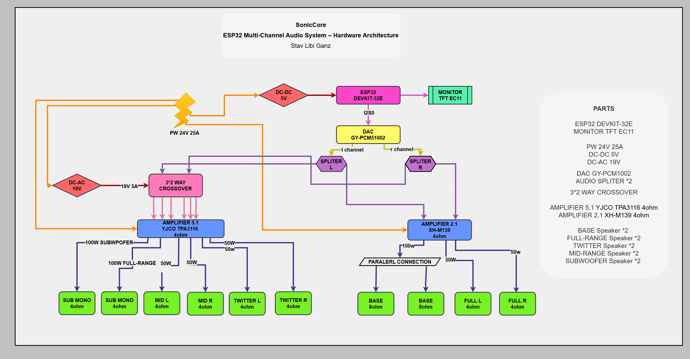

# ESP32 Sonic Core

A multi-channel audio system based on the ESP32, designed for digital audio processing and independent speaker control.

## About

I'm developing this project to build a custom audio system from the hardware level up, including audio processing, communication, amplification and user controls.

The system uses two I2S interfaces connected to separate stereo DACs, providing four independent analog audio channels.

## Hardware

The current design includes:
- ESP32 DEVKIT-32E
- MONITOR TFT EC11
- PW 24V 25A
- DC-DC 5V
- DC-AC 19V
- DAC GY-PCM1002
- AUDIO SPLITER *2
- 3*2 WAY CROSSOVER
- AMPLIFIER 5.1 YJCO TPA3116 4ohm
- AMPLIFIER 2.1 XH-M139 4ohm
- BASE Speaker *2 
- FULL-RANGE Speaker *2
- TWITTER Speaker *2
- MID-RANGE Speaker *2
- SUBWOOFER Speaker *2 

- ## Hardware Architecture
As of November 9, 2026

## Software

The firmware is being designed with separate modules for:

- Audio input and decoding
- Digital signal processing (DSP)
- Equalizer and frequency filtering
- Audio routing through dual I2S interfaces
- Multimedia playback and controls
- Bluetooth communication

The goal is to keep the audio processing, hardware communication and user interface independent, making the system easier to develop, test and expand.

## Development

## LOG
- 09/11/26 The project diagram is finally ready. still looking to get missing parts for the circuit. missing parts: 4 way amplifier, voltage reducer, 3 way crossover. Today also started coding.
- 10/11/26 I'm a proud gal i finished the design. definitely hipped and looking forward to make a progress. Also ordered the parts but the main Power Supply, will do after the shipping arrive.
- 13/11/26 I fineshed the design for the player using sqarelines for lvgl. its a retro style beaver 2d inspired design. i think its lookiing sharp lulz

