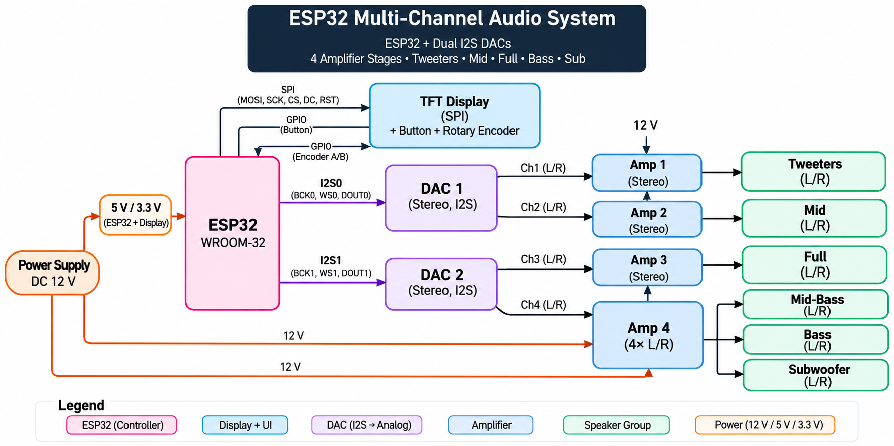

# ESP32 Sonic Core

A multi-channel audio system based on the ESP32, designed for digital audio processing and independent speaker control.

## About

I'm developing this project to build a custom audio system from the hardware level up, including audio processing, communication, amplification and user controls.

The system uses two I2S interfaces connected to separate stereo DACs, providing four independent analog audio channels.

## Hardware

The current design includes:
- ESP32-WROOM-32E
- 2x PCM5102A stereo DACs
- External amplifiers
- Multiple speaker groups
- TFT display with rotary encoder
- Custom transparent enclosure

- ## Hardware Architecture
As of November 9, 2026

## Software

The firmware is being designed with separate modules for:

- Audio input and decoding
- Digital signal processing (DSP)
- Equalizer and frequency filtering
- Audio routing through dual I2S interfaces
- Multimedia playback and controls
- Bluetooth communication

The goal is to keep the audio processing, hardware communication and user interface independent, making the system easier to develop, test and expand.

## Development

The project is currently in the hardware planning and system design stage.

I'm documenting the design decisions, implementation process and technical challenges throughout development.

Hardware specifications and development tasks are tracked in the repository's Issues.
